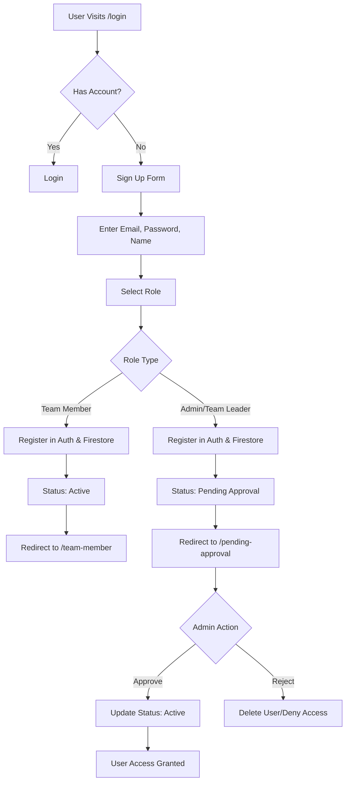
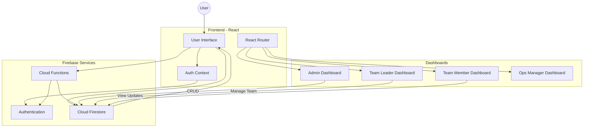

# Application Flowcharts

## 1. Signup Process

This flowchart describes the user registration, role selection, and approval workflow.

## 2. General System Architecture

This flowchart illustrates the high-level interaction between the Frontend, Firebase Services, and different User Roles.

